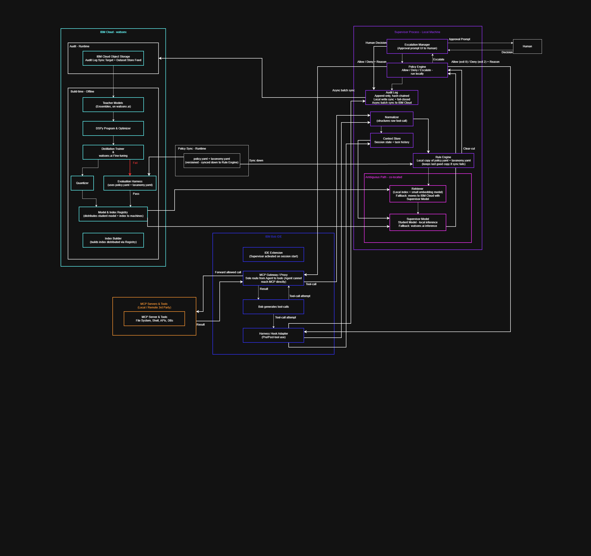
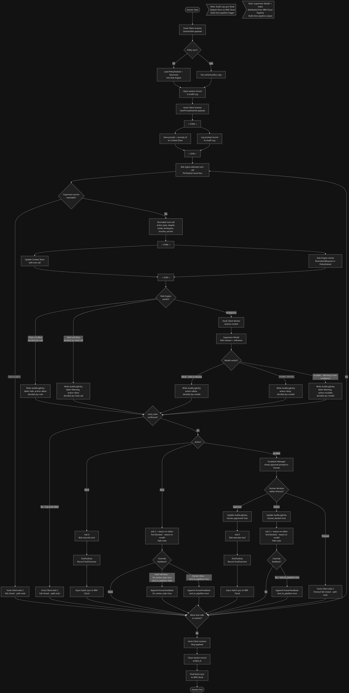
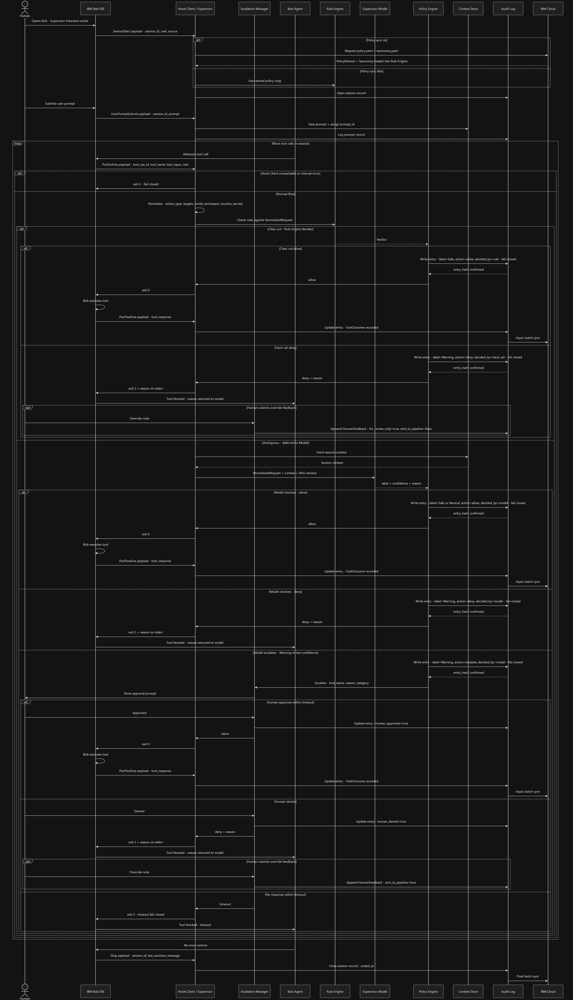
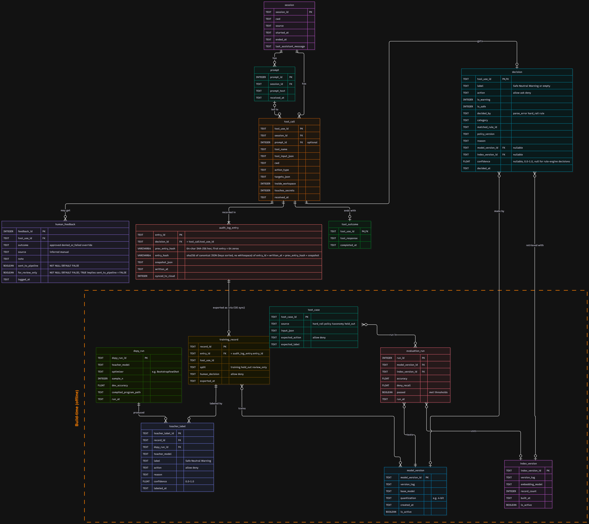

# AI Permission Supervisor

A local guardrail for AI coding agents. It intercepts every tool call the
**IBM Bob** agent attempts (reading and writing files, running shell
commands, and so on), classifies it, and then **allows** it, **denies** it
with a reason the agent can read, or **escalates** it to you for approval,
before the tool runs.

Routine actions pass silently, dangerous ones are blocked by hard rules,
and only the uncertain ones reach you. That keeps a human in control without
the approval fatigue of clicking "allow" on every command.

Built by Team TINSY for IBM SkillsBuild, Fall 2026.

> **Status: v0.1.0 (beta), rules only.** Decisions come from the policy file.
> Anything the rules do not cover is escalated to you. A distilled model that
> judges ambiguous cases automatically is planned (see
> [the implementation plan](ai-permission-supervisor-plan.md)).
> Supported agent: **IBM Bob** (IDE and Bob Shell).

## Quick start

Requires Python 3.10 or newer and IBM Bob, on Windows, macOS, or Linux.

```bash
pip install ai-permission-supervisor

aps install --bob-auto-approve   # register the hooks in Bob's global settings
aps autostart enable             # start the Supervisor at every login
aps start                        # start it now
aps doctor                       # check that everything is set up correctly
```

Then restart Bob. Ask it to list your files (allowed silently) and to run a
command such as `npm test` (an approval page opens in your browser).

> **Important:** once the hooks are installed, Bob's tool calls are **denied
> whenever the Supervisor is not running**. That is deliberate (fail-closed).
> Keep it running with `aps autostart enable`, or remove the hooks with
> `aps uninstall`.

If `aps` is not found after installing, Python's scripts folder is not on
your PATH. Use `python -m ai_permission_supervisor.cli` instead of `aps`.

To install the latest version straight from GitHub instead of PyPI:

```bash
pip install "git+https://github.com/TonyINSY6629/IBM_SkillBuild_Fall2026_Team_TINSY_AI-Permission-Supervisor-System.git"
```

## What it decides

| Situation | Decision |
|---|---|
| Reading or writing ordinary files inside your workspace | Allowed, no prompt |
| Read-only commands: `git status`, `git diff`, `git log`, `python --version`, `dir`, `ls`, … | Allowed, no prompt |
| Writing outside the workspace, writing secret files (`.env`, keys) | Always denied |
| Touching the Supervisor itself: its files, its policy, its log, Bob's settings, its local API | Always denied |
| Everything else: other shell commands, network access, installs | Escalated to you |
| You don't answer within 120 seconds, or the Supervisor is down or fails | Denied |

Every decision is written to a tamper-evident, hash-chained audit log
(`~/supervisor_audit/audit_log.jsonl`) **before** it takes effect. If the log
cannot be written, the call is denied.

A command that chains or redirects (`git status && del *`, `ls > out.txt`) is
never auto-allowed, even when it starts with an allowed command.

## How it works

```
 Bob agent ──tool call──► PreToolUse hook ──► Hook Client ──► Supervisor service (local, 127.0.0.1:9001)
                                                │               ├─ Normalizer      → structured request
               exit 0 = allow  ◄────────────────┤               ├─ Rule Engine     → hard rails, allow rules
               exit 2 = deny + reason ◄─────────┘               ├─ Policy Engine   → allow / deny / escalate
                                                                ├─ Escalation      → approval page → you
                                                                └─ Audit Log       → hash-chained, then IBM Cloud
```

1. Bob runs the Supervisor's **Hook Client** before every tool call
   (`PreToolUse` hook, registered globally so the agent cannot edit it).
2. The Hook Client forwards the call to the local **Supervisor service** and
   waits. It allows the tool only on an explicit "allow"; any error, timeout,
   or missing service means deny.
3. The service **normalizes** the call (action type, targets, inside the
   workspace or not, secrets), checks the **policy** (hard rails first, then
   allow rules), and **escalates** whatever is left to you.
4. The decision is **logged**, then returned to Bob as an exit code. On deny,
   the reason is passed back to the agent so it can try another approach.

### Architecture



The runtime (right) runs entirely on your machine. IBM Cloud and watsonx.ai
(left) hold the audit-log copy and the build-time pipeline that will train the
local model. The MCP Gateway, the Retriever, the Supervisor Model, and the
build-time pipeline are part of the design but not yet in v0.1.

### Runtime decision flow



### A full session, step by step



### Data model



Runtime records (top) are written locally for every decision; the build-time
records (bottom, dashed) live on IBM Cloud and track training data, model
versions, and evaluation runs.

### Build-time pipeline (planned)


Audit-log entries are exported to IBM Cloud Object Storage, labeled by teacher
models on watsonx.ai (prompts optimized with DSPy), and distilled into a small
quantized student model. A model reaches users only after passing an
evaluation gate on held-out and adversarial test cases.

Source files for all diagrams are in [`diagrams/`](diagrams/).

## Commands

| Command | What it does |
|---|---|
| `aps install` | Add the Supervisor hooks to Bob's global settings (backup first, other settings untouched) |
| `aps install --bob-auto-approve` | Also turn on Bob's own auto-approve for read, edit, and shell commands, so you see one prompt instead of two |
| `aps uninstall` | Remove the hooks, and the auto-approve settings `aps install` added |
| `aps start` / `aps stop` | Start or stop the service in the background |
| `aps status` | Is the service running, are the hooks installed, which policy is active |
| `aps doctor` | Check packages, policy, hooks, auto-approve, timeout ordering, and service health |
| `aps autostart enable` / `disable` | Start at login: Windows Startup folder, macOS LaunchAgent, or systemd user service |
| `aps policy init` / `aps policy path` | Create your own editable policy, or show which one is active |

Files the CLI manages live in `~/.ai_permission_supervisor/`: settings
backups, your policy, an optional `.env`, the service log, and the pid file.
The agent can neither read nor change this folder.

### Why `--bob-auto-approve`?

Bob has its own approval prompt in front of tools. With the Supervisor
installed, that means two prompts per command. `--bob-auto-approve` turns on
Bob's auto-approve for **read, edit, and execute** only, so the Supervisor is
the single gate. MCP tools are left on Bob's own prompt, because it is not yet
confirmed that Bob's hook fires for MCP calls. `aps uninstall` turns off exactly
what it turned on; if you enabled auto-approve yourself, it warns you, because
without the Supervisor those commands would run unchecked.

## Customizing the policy

```bash
aps policy init      # copies the default policy to ~/.ai_permission_supervisor/policy/
aps stop && aps start
```

Edit `policy.yaml` in that folder. The service reloads it every 5 minutes.
Rules are evaluated in order: **hard rails** (deny), then **allow rules**,
then the **default** (escalate). An allow rule for read-only shell commands
looks like this:

```yaml
- id: al-003
  condition:
    category: shell_exec
    command_matches:          # the WHOLE command must match one regex
      - 'git status( (-s|-sb|--short))*'
      - 'python3? (--version|-V)'
  verdict: { action: allow, decided_by: rule, label: Safe, reason: "Read-only command" }
```

## Configuration

Set these as environment variables, or in `~/.ai_permission_supervisor/.env`
(read by the service, not by the Hook Client).

| Variable | Default | Meaning |
|---|---|---|
| `SUPERVISOR_HOST` / `SUPERVISOR_PORT` | `127.0.0.1` / `9001` | Where the service listens |
| `ESCALATION_TIMEOUT_SECONDS` | `120` | How long to wait for your approval |
| `HOOK_DEADLINE_SECONDS` | `130` | Hook Client deadline (environment only) |
| `ESCALATION_OPEN_BROWSER` | `1` | Open the approval page automatically |
| `ESCALATION_POPUP_URL` | `builtin` (with `aps start`) | `builtin` for the page served by the Supervisor, or the URL of the React pop-up in `UI/` for development |
| `AUDIT_LOG_PATH` | `~/supervisor_audit/audit_log.jsonl` | Audit log location |
| `POLICY_DIR` | your policy, else the default | Folder with `policy.yaml` and `taxonomy.yaml` |
| `COS_API_KEY`, `COS_INSTANCE_ID`, `COS_AUDIT_BUCKET` | unset | Optional audit-log sync to IBM Cloud Object Storage (`pip install "ai-permission-supervisor[cloud]"`) |

The timeouts must keep this order, or a slow approval would let the tool run:
**escalation timeout < Hook Client deadline < Bob hook timeout (150 s)**.
`aps doctor` checks it.

## Uninstall

```bash
aps autostart disable
aps stop
aps uninstall
pip uninstall ai-permission-supervisor
```

Restart Bob afterwards. Your audit log stays in `~/supervisor_audit/`.

## Security model and limitations

- **Fail-closed.** Service down, errors, timeouts, and unknown answers all mean
  deny. Nothing takes effect without an audit-log entry.
- **The agent cannot judge itself.** The Supervisor runs as a separate process,
  and the hard rails deny any attempt to read or change its files, its policy,
  Bob's settings, or to call its local API.
- **Same user account.** The Supervisor runs as your user, like the agent. The
  hard rails block the direct routes to disable it, but this is not isolation
  in the operating-system sense.
- **Hook Client crash fails open.** If the Hook Client process itself crashes
  (not just errors), Bob runs the tool. It is kept small, standard-library
  only, and catches every exception to make this unlikely.
- **MCP tools** are not yet confirmed to pass through Bob's hook.
- **Linux autostart** runs as a systemd user service, which may not be able to
  open your browser. The approval URL is also written to
  `~/.ai_permission_supervisor/supervisor.log`.

## Development

```bash
git clone https://github.com/TonyINSY6629/IBM_SkillBuild_Fall2026_Team_TINSY_AI-Permission-Supervisor-System.git
cd IBM_SkillBuild_Fall2026_Team_TINSY_AI-Permission-Supervisor-System
python -m venv .venv && source .venv/bin/activate   # Windows: .venv\Scripts\activate
pip install -e ".[dev]"            # add ,teacher,cloud for the training pipeline
python -m pytest
```

| Path | Contents |
|---|---|
| `ai_permission_supervisor/supervisor/` | The service: normalizer, rule and policy engines, escalation, audit log, COS sync |
| `ai_permission_supervisor/hook_client/` | The Hook Client Bob runs (standard library only) |
| `ai_permission_supervisor/policy/` | Default `policy.yaml` and `taxonomy.yaml` |
| `ai_permission_supervisor/cli/` | The `aps` command |
| `teacher/`, `scripts/` | Build-time pipeline: dataset export, DSPy teacher on watsonx.ai |
| `UI/` | React escalation pop-up (development) |
| `tools/probe/` | Step 1 probe hook used to record Bob's real payloads |
| `diagrams/` | Architecture, sequence, activity, and ERD diagrams |

**Working on the Supervisor with Bob while it is installed:** by default the
Supervisor protects its own package, so Bob cannot edit this repository's
`ai_permission_supervisor/` folder. Set `APS_ALLOW_SELF_EDIT=1` in
`~/.ai_permission_supervisor/.env` and restart the service to allow it. The
active policy and the state folder stay protected either way.

Releasing a new version is described in [PUBLISHING.md](PUBLISHING.md).

## License

Not yet chosen. Until a license is added, all rights are reserved by the authors.
